# 任务管理器 + 文件资源管理器（Web 版）

仿 Windows 11 的系统监控页面，包含总览、性能、进程、详细信息、用户、服务、网络连接七个视图，并直接铺满浏览器窗口（没有最小化 / 全屏 / 关闭按钮）：

- **总览**：仿文件资源管理器的磁盘总览，带磁盘健康徽标、容量条、每块盘的实时读取 / 写入速度、健康报告、跨盘拷贝动画与文件列表，以及底部的远程设备 / 外网传输区
- **性能**：仿任务管理器的 CPU / 内存 / 磁盘 60 秒实时曲线，大图带 Y 轴刻度和 X 轴时间刻度
- **进程**：进程列表，点击表头的 **名称 / CPU / 内存** 排序（再次点击切换升降序），带占用条形图、磁盘读写、线程、用户和状态
- **详细信息**：完整进程树，按父子关系缩进，参考 `ps -auxf` 使用 `├─` / `└─`，点击行或箭头展开/折叠，支持全部展开/折叠，每 3 秒刷新并保留展开状态
- **用户**：登录会话 + 网络客户端，显示连接数、来源 IP、终端、登录时间和当前命令
- **服务**：读取 `systemctl` 的服务列表和当前运行 / 失败 / 未激活状态，支持搜索
- **网络连接**：TCP / UDP 的入站、出站、监听连接，显示协议、应用、本地 / 远程地址、接收 / 发送速率和累计流量；Docker 容器（如 Jellyfin 推流）以「容器」行显示容器级聚合流量
- **远程传输**：除 SMB / OpenList 入站设备外，还会识别 OpenList / FileBrowser / Kodbox 等文件服务容器的**外网上传**流量，合并到固定的地球图标上；地球状态显示「外网上传」，虚线终点有箭头、飞机从磁盘飞向地球。文件服务的小标签显示在实际读取最忙的**源磁盘卡片**上，不再放在地球或单独做成「下载」卡片

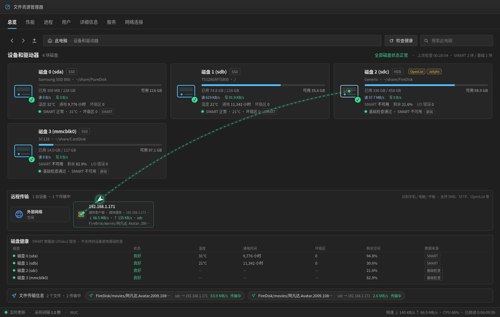

## 演示

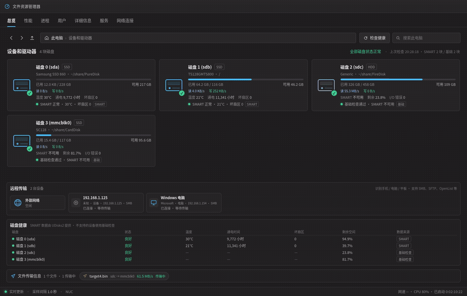

[下载 MP4](recordings/demo.mp4)


前端原生 HTML / CSS / Canvas，后端只使用 Node.js 标准库，直接读取 Linux 的 `/proc`、`/sys` 和 UDisks2 的 D-Bus 接口，**不需要 npm install**。

## 功能

### 进程页

- 顶部显示进程总数、CPU 总占用、内存占用、磁盘读写总量
- 表格列：名称、PID、状态、CPU、内存、磁盘、线程、用户
- CPU / 内存列使用**条形图**呈现（条形长度按当前列表最大值缩放，文字显示真实百分比）
- 排序：点击表头的名称 / CPU / 内存排序，再次点击切换升序 / 降序
- 搜索框可按进程名、命令行、PID、用户名过滤
- 进程名自动处理 `MainThread` 这类无意义 comm（回退到命令行首段），完整命令行在行的悬停提示里
- 状态中文化：运行、睡眠、等待 I/O、僵尸、停止、空闲
- 每 2 秒更新一次；列表取 **CPU 最高的 60 个 + 内存最高的 60 个**（并集约 100 个），避免一次渲染数百行

CPU 百分比是**占全部逻辑处理器**的比例（4 核机器上跑满一个核显示约 25%），与「性能」页的整体 CPU 曲线一致。

### 详细信息页

- 完整进程树（`/proc` 全量进程），按父子关系缩进
- 列：用户、PID、PPID、CPU、内存、状态、命令
- 参考 `ps -auxf` 用 `├─` / `└─` / `│` 表示层级
- 点击任意行或箭头展开 / 折叠；支持「全部展开」「全部折叠」
- 每 3 秒刷新，并保留当前展开状态

### 性能页

- **性能概览**：CPU、内存、磁盘读写三张曲线同屏，Y 轴显示百分比 / 速率刻度
- **CPU**：利用率曲线、当前频率、进程 / 线程数、逻辑处理器、缓存、正常运行时间
- **内存**：使用率曲线、已用 / 可用 / 已缓存 / 交换、内存组成条
- **磁盘**：全部磁盘合计的写入 / 读取速率，或点开每一块物理磁盘查看单独的读取 / 写入速率、活动时间占比、平均响应时间、IOPS、容量和挂载点
- 鼠标悬停曲线查看某一秒的具体数值

### 总览（文件资源管理器风格）

- 顶栏：前进 / 后退 / 向上、地址栏「此电脑」、搜索框、手动健康检查按钮
- 磁盘卡片：驱动器图标、SSD / HDD / 可移动标签、容量条、型号与挂载点
- **健康状态直接显示在磁盘图标上**：绿色 ✓ / 琥珀 ! / 红色 × / 灰色 ?
- 卡片内显示温度、通电时间、坏扇区、剩余空间和检查来源（SMART / 基础检查）
- 底部健康报告表格：逐块磁盘列出状态、温度、通电时间、坏扇区、剩余空间、数据来源
- 点击磁盘卡片（或健康报告行）跳转到「性能」页对应的磁盘详情
- 窗口变窄自动 2 列 / 1 列，窗口较矮时自动收起健康报告

### 远程传输（总览底部）

总览页在磁盘卡片和健康报告之间增加了一个「远程传输」区：

- 左侧固定一个**地球图标**代表外部网络
- 右侧列出正在连接本机文件服务的设备卡片，显示设备类型（手机 / 平板 / 电脑）、厂商、IP、协议（SMB / SFTP / OpenList 等）和传输速率
- 通过 SMB、SFTP、OpenList、NFS、FTP、HTTP 等端口检测正在进行的文件传输
- 传输中的设备与对应磁盘之间会画**虚线曲线**，小飞机按数据方向移动（下载：磁盘 → 设备；上传：设备 → 磁盘）
- 外网设备下载 / 上传大文件时，地球图标会激活，并画一条「地球 ↔ 磁盘」的曲线
- **aria2 容器内下载**通过 aria2 JSON-RPC 检测：读取活动下载速度，按容器挂载目录映射到磁盘，并作为「外网下载」显示在地球上（地球 ↔ 磁盘虚线 + 飞机）
- 空闲的 SMB / OpenList 会话也会显示为「已连接」；SSH、HTTP 只在真正有流量时出现
- 文件共享端口（SMB / SFTP / OpenList / NFS / FTP）**8 KB/s** 即触发，**500 ms** 采样一次，最后一次流量后再保持 **10 秒**；HTTP 端口仍用 256 KB/s 阈值，避免普通网页流量误报
- 设备状态在轮询间持久保留，磁盘映射阈值降到 32 KB/s 并会沿用上一块磁盘，减少小文件 / 断续传输时曲线闪烁或消失
- 设备识别是尽力而为：优先使用浏览器 User-Agent（访问本页面时记录），其次 MAC OUI 厂商库（nmap）、mDNS / NetBIOS 主机名和协议特征；随机 MAC 会标注「随机 MAC」
- **OpenList** 的源盘通过 `docker exec` 读取容器内 `/proc/*/fd` 的打开文件路径，再映射到宿主机磁盘；**SMB** 通过 `smbstatus` + 宿主 `smbd` 的 fd 精确取源盘/目标盘；拿不到 fd 时才退回读写速率推断
- SMB 设备卡片和底部「文件传输信息」会显示 `smbstatus` / fd 读到的真实文件名（例如 `FireDisk/public/登记照视频花絮/VID_20250405_170734.mp4`）

> 真实连接：Windows 电脑与 192.168.1.125 通过 SMB 连接；传输中的设备和对应磁盘之间会画虚线，小飞机按方向移动。


aria2 容器内下载通过 aria2 JSON-RPC 识别，作为「外网下载」显示在地球上；OpenList 外网上传显示为「外网上传」，标签落在源磁盘卡片上。

### 磁盘容量计算

容量条通过 `statfs` 读取：

- **已用** = 总块数 − 空闲块数（`bfree`），只统计实际文件占用
- **可用** = 普通用户可用块数（`bavail`），与 `df` 的 Avail 一致
- ext4 默认会为 root 保留 5% 的块，这部分**不计入已用**；鼠标悬停容量条可以看到「系统保留」大小（例如 sda 约 11.7 GB）

### 磁盘健康检查

- **SMART（SATA 等）**：通过 UDisks2 的 `Drive.Ata` 接口读取，无需 root
  - 整体健康自检、温度、通电小时、坏扇区、失败属性数、上次自检状态
- **基础检查（所有磁盘）**
  - 挂载状态、文件系统类型、是否只读挂载
  - 剩余空间（低于 10% 注意，低于 3% 严重）
  - 最近 24 小时内核日志里的 I/O 错误（`journalctl -k`，有权限时）
- USB 桥接硬盘、SD 卡等没有 ATA/SMART 接口的设备自动降级为基础检查，并在卡片上标注「基础」
- 服务端每 60 秒自动检查一次，也可以点「检查健康」立即刷新
- 磁盘被热插拔时自动重新检查

> SMART 数据由系统的 `udisksd` 提供，因此需要 UDisks2 + `gdbus`（桌面版 Linux 通常自带）。没有 UDisks2 时只显示基础检查结果。

### 跨盘拷贝检测与传输动画

当检测到一块磁盘向另一块磁盘复制文件时：

- 在两块磁盘的图标之间画一条虚线贝塞尔曲线
- 小飞机图标（带深色底盘和光晕）沿着曲线从来源盘飞向目标盘，带尾迹
- 曲线两端有来源 / 目标圆环，目标端持续脉冲
- 底部「文件传输信息」栏显示检测到的文件列表：文件名、源盘 → 目标盘、速率、传输中 / 已结束；最多同时画 4 条曲线
- 文件列表在本次页面会话内保留最近 30 个文件（横向滚动，默认展示 8 个）；拷贝结束后曲线和图标短暂停留再淡出，文件仍以「已结束」留在列表中
- 没有检测到文件时显示「暂无检测到的本机跨盘传输文件」


root 发起的 rsync 批量拷贝只能通过命令行路径 + 磁盘速率估算，普通用户读不到 root 进程的 fd。

检测方式（服务端，每 500 ms 扫描一次）：

1. **同进程 fd 对**：从 `/proc/<pid>/fd` 找同一进程持有的「来源盘只读文件」和「另一块盘可写文件」，结合 `/proc/<pid>/fdinfo` 判断读写模式；结合磁盘读写速率确定方向。文件管理器等未知拷贝工具靠这一层。
2. **命令行路径**：对 `rsync`、`cp`、`mv`、`dd`、`gio` 解析 `/proc/<pid>/cmdline` 里的源 / 目标路径。`rsync` 的读写常在不同进程，靠这一层识别。
3. **root 拷贝退化检测**：普通用户读不到 root 进程的 `/proc/<pid>/io` 和 `fd`，但 `cmdline` 通常可读；对 root 的 `rsync` / `cp` 等用命令行路径 + 磁盘读写速率估算，能显示跨盘传输；使用 `--files-from` 时显示清单名和文件数，无法精确到当前单个文件。
4. 只显示**跨物理磁盘**的拷贝；同一块盘的不同分区之间不算。
5. 结束的传输会保留约 3 秒用于淡出。

限制：

- 同用户拷贝可以通过 `/proc/<pid>/io` / `fd` 精确检测；root 发起的拷贝只能退化到命令行路径 + 磁盘速率，无法读取 fd，所以显示的是源/目标目录或 `--files-from` 清单名，而不是当前单个文件。
- 如果 root 拷贝使用相对路径、且其 cwd 不可读，可能无法解析源/目标路径。
- 持续时间短于约 0.5 秒的拷贝可能捕捉不到
- 网络拷贝（scp、rsync 远程路径）不会显示

## 截图

| 总览（跨盘拷贝动画 + 远程传输） | 进程（按 CPU 排序） |
| --- | --- |
|  | 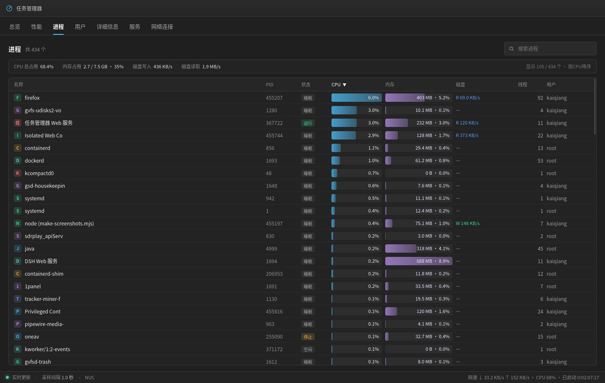 |

| 进程（按内存排序） | 性能概览（带刻度） |
| --- | --- |
| 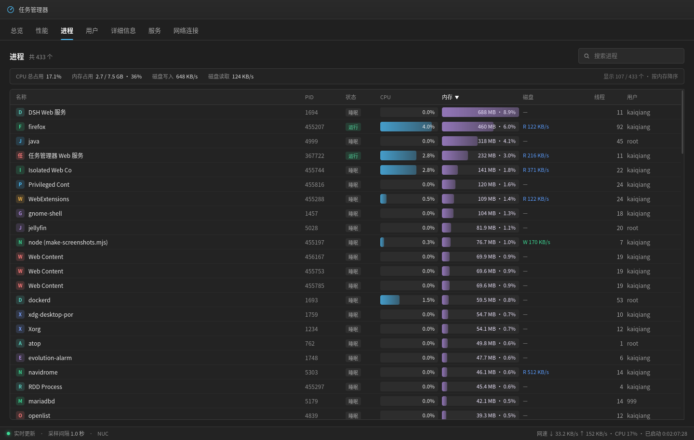 | 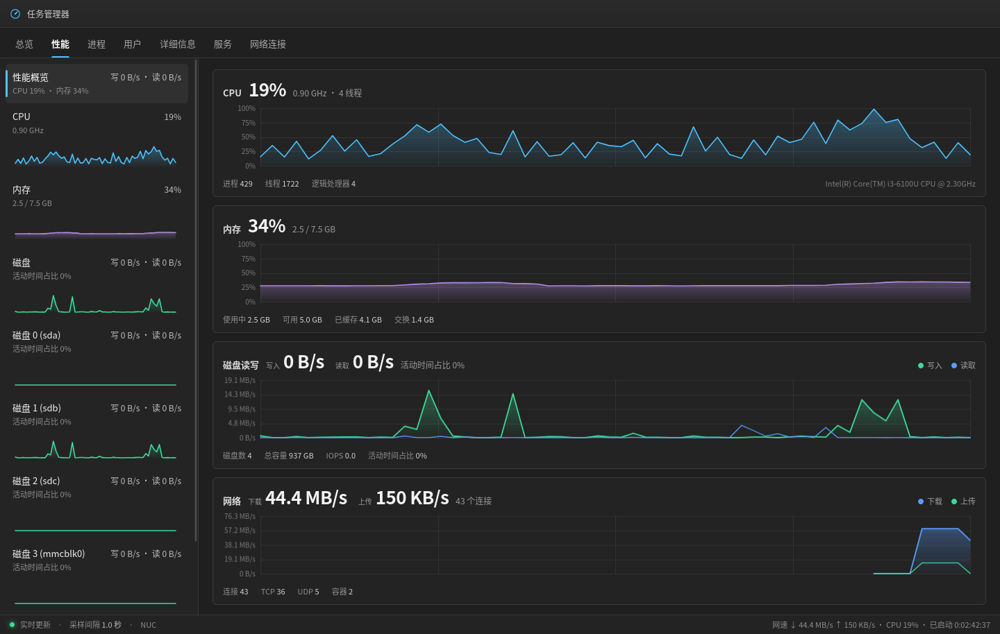 |

| CPU 详情（带刻度） | 磁盘详情（带刻度） |
| --- | --- |
| 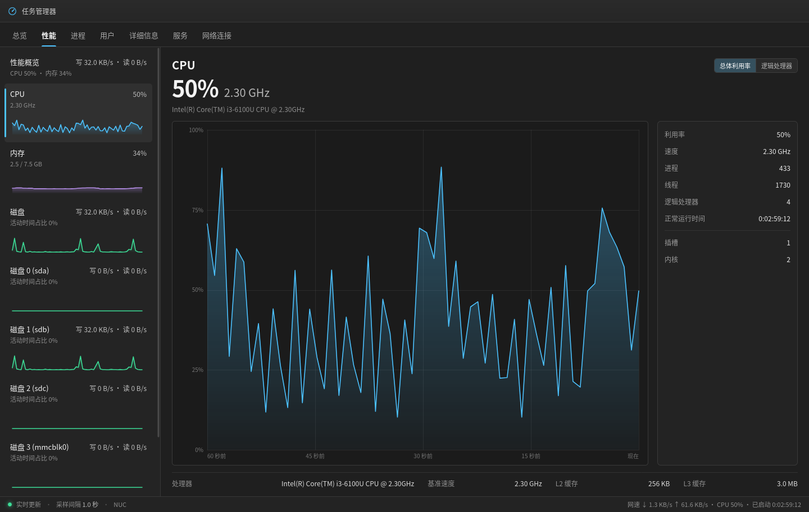 | 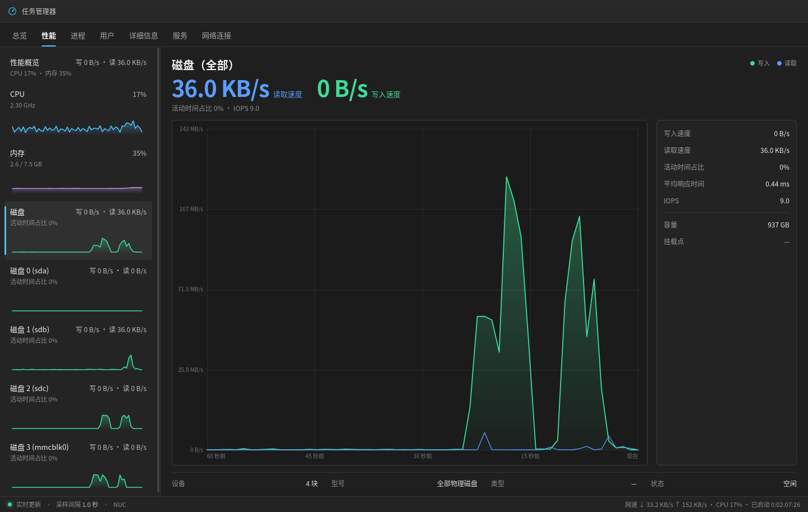 |

| 详细信息（进程树） | 用户（登录 + 网络客户端） |
| --- | --- |
| 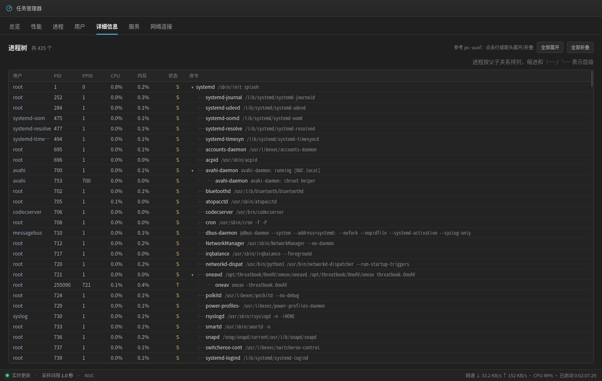 | 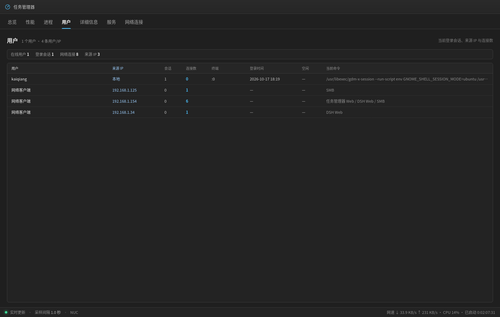 |

| 服务（systemctl） | 网络连接 |
| --- | --- |
| 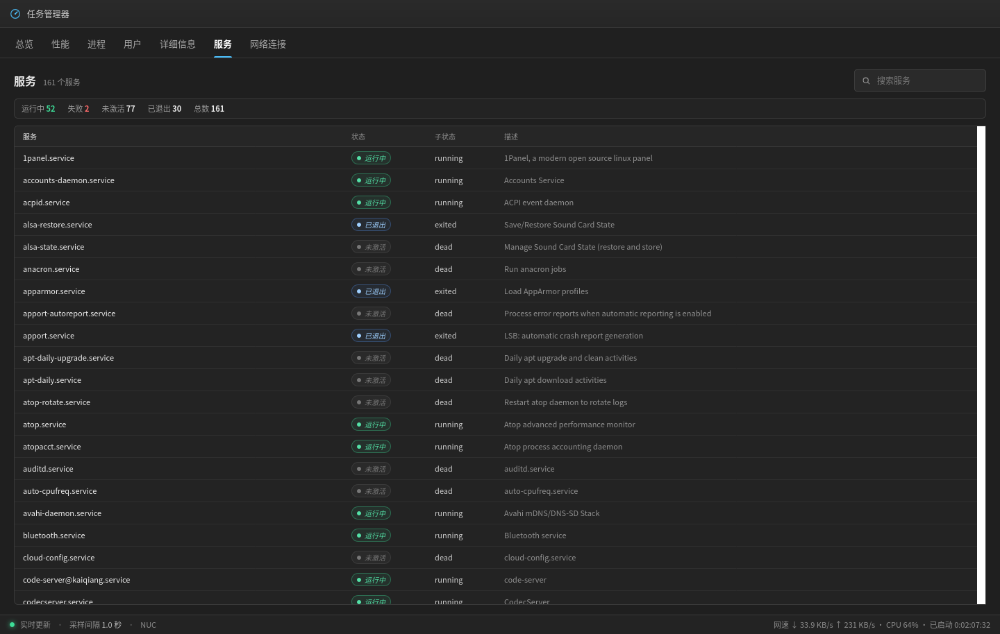 | 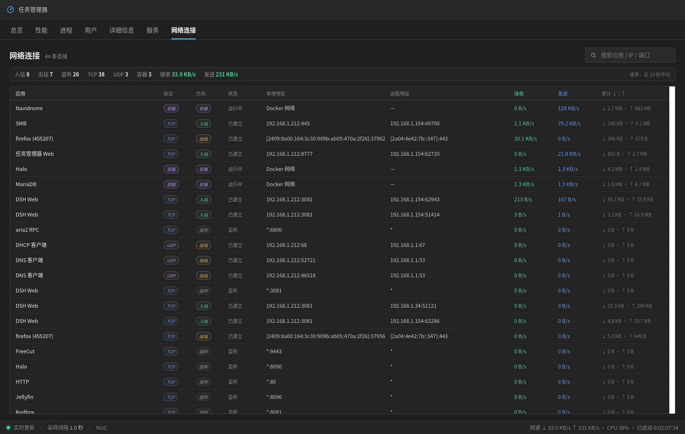 |

| 远程设备 | 文件传输信息 |
| --- | --- |
|  |  |

小窗口（1024 × 626）：

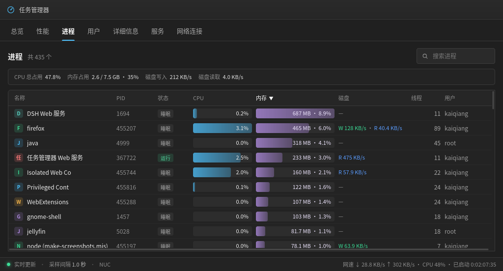

## 运行

要求：**Linux**（`/proc`、`/sys`）+ **Node.js 18.15 及以上**（使用 `fs.statfsSync`）。

> OpenList / SMB 的精确源盘识别需要 Docker（当前用户在 `docker` 组）。应用会自动创建 `tm-smb-helper`（privileged + host pid）读取 `smbstatus` 和 `smbd` 的 fd；没有 Docker 时自动退回读写速率推断。

```bash
cd task-manager-web
npm start            # 等价于 node server.js
```

默认监听所有网卡（`0.0.0.0`），打开：

```
http://<本机局域网 IP>:8777
http://127.0.0.1:8777
```

如果只想本机访问：

```bash
HOST=127.0.0.1 PORT=8777 node server.js
```

| 变量 | 默认值 | 说明 |
| --- | --- | --- |
| `PORT` | `8777` | 监听端口 |
| `HOST` | `0.0.0.0` | 监听地址；只本机用可设为 `127.0.0.1` |
| `SAMPLE_MS` | `1000` | 性能采样间隔（毫秒） |

停止：`Ctrl+C`，或 `pkill -f "node server.js"`。

### 复现传输动画

准备两块不同的磁盘，在总览页打开的情况下执行：

```bash
dd if=/dev/zero of=/mnt/diskA/demo.bin bs=1M count=600
cp /mnt/diskA/demo.bin /mnt/diskB/demo.bin
```

总览页会显示 `diskA → diskB` 的曲线和小飞机。`rsync --bwlimit=40m` 这类持续较久的拷贝效果更明显。

## 数据来源

| 指标 | 来源 | 算法 |
| --- | --- | --- |
| CPU 利用率 / 频率 | `/proc/stat`、`cpufreq` | 两次采样差分，各核心平均频率 |
| 内存 | `/proc/meminfo` | 使用中 = `MemTotal - MemAvailable` |
| 磁盘读写速率 | `/proc/diskstats` | Δ扇区 × 512 ÷ Δt |
| 磁盘活动时间占比 / IOPS / 延迟 | `/proc/diskstats` | `io_ticks`、IO 次数、读写耗时 |
| 每块盘读取 / 写入速度 | `/proc/diskstats` | 每秒扇区数差分 × 512 |
| 磁盘容量 / 剩余空间 | `fs.statfsSync()` | `statvfs` |
| 磁盘型号 / 挂载点 / 只读 | `/sys/block`、`/proc/mounts` | — |
| SMART | UDisks2 `Drive.Ata`（`gdbus`） | 温度、通电时间、坏扇区、自检状态 |
| 内核 I/O 错误 | `journalctl -k --since "24 hours ago"` | 关键字 + 设备名匹配 |
| 跨盘拷贝 | `/proc/<pid>/io`、`fd`、`fdinfo`、`cmdline`、`/proc/mounts` | 进程 fd 对 + 拷贝命令路径 |
| 进程 CPU | `/proc/<pid>/stat` | Δ(utime + stime) ÷ USER_HZ ÷ Δt ÷ 逻辑核数 |
| 进程内存 | `/proc/<pid>/stat` | rss 页数 × 4096 |
| 进程磁盘 IO | `/proc/<pid>/io` | Δread_bytes / Δwrite_bytes |
| 进程用户 / 命令 | `/proc/<pid>/status`、`cmdline`、`/etc/passwd` | 只对展示的进程读取 |
| 用户登录会话 | `who -u`、`w -h` | 用户、终端、来源 IP、登录时间、空闲、当前命令 |
| 用户连接数 | `ss -tn` | 按来源 IP 统计到本机服务端口的 ESTAB 连接 |
| 服务状态 | `systemctl list-units --type=service --all` | 服务名、load、active、sub、描述 |
| 网络连接 | `ss -tunapi` | TCP / UDP 连接、进程、字节计数、方向 |
| OpenList 源盘 | `docker exec openlist` + `/proc/*/fd` | 打开文件路径 → 挂载磁盘 |
| SMB 源盘/目标盘 | `smbstatus` + `/proc/<smbd>/fd`（root helper） | 会话/IP/文件 → 磁盘 |
| 网络应用识别 | `ss -p` + 本地端口服务表 | 进程名 / PID，root 服务按端口识别 |
| Docker 容器网络 | `docker stats --no-stream` | 容器级 rx / tx 累计字节差分 |
| 远程文件连接 | `ss -tinp` | 本机文件服务端口上的 ESTAB 连接、累计字节差分 |
| 远程设备 MAC | `ip neigh` | IP → MAC，判断局域网 / 外网 |
| 设备厂商 | `/usr/share/nmap/nmap-mac-prefixes` | MAC OUI → 厂商；随机 MAC 单独标注 |
| 设备类型 | 浏览器 User-Agent、主机名（avahi / nmblookup）、OUI | 手机 / 平板 / 电脑 / 设备 |
| 远程对应磁盘 | 本机磁盘读写速率 | 下载取读取最高的盘，上传取写入最高的盘 |
| aria2 下载 | aria2 JSON-RPC（`getGlobalStat` / `tellActive`） | 下载速度、活动任务目录 |
| aria2 容器挂载 | `docker inspect` | 容器内 `/downloads` → 宿主目录 → 磁盘 |

磁盘统计只包含整块物理盘（`sd*`、`hd*`、`vd*`、`nvme*n*`、`mmcblk*`），排除分区、`loop`、`dm` 等虚拟设备。

## API

| 路径 | 说明 |
| --- | --- |
| `GET /api/info` | 静态信息：CPU、内存、磁盘列表（含容量、挂载点、只读、可移动） |
| `GET /api/history` | `{ info, samples, health, transfers, processes }`，最近 60 个采样点 |
| `GET /api/processes` | 当前进程快照（总数 + 占用最高的进程列表） |
| `GET /api/health` | 磁盘健康检查结果，包含每块盘的 SMART / 基础检查详情 |
| `GET /api/health/refresh` | 触发一次异步健康检查，立即返回 |
| `GET /api/transfers` | 当前 / 最近 3 秒内的跨盘传输 |
| `GET /api/remote` | 远程文件传输设备、外网传输状态 |
| `GET /api/users` | 登录会话、网络客户端、连接数、来源 IP |
| `GET /api/services` | systemctl 服务列表与运行状态 |
| `GET /api/network` | 网络连接、协议、方向、应用、速率和累计流量 |
| `GET /api/stream` | SSE：`history`、`sample`、`health`、`transfers`、`processes`、`remote`、`users`、`services`、`network`、`info` |
| `GET /healthz` | 健康检查（服务本身） |

SSE 事件：

- `sample`：每秒一个采样点，含 `cpu`、`mem`、`disk`、`transfers`
- `processes`：每 2 秒一个进程快照
- `remote`：远程文件传输 / 外网传输状态，每 1 秒推送
- `users`：登录用户 / 网络客户端，每 5 秒推送
- `services`：systemctl 服务状态，每 10 秒推送
- `network`：网络连接与实时速率，每 2 秒推送
- `health`：健康检查开始 / 完成时推送
- `transfers`：跨盘传输变化时推送
- `info`：磁盘热插拔时推送

进程快照示例：

```json
{
  "at": 1792215172655,
  "total": 416,
  "cpuCount": 4,
  "memTotal": 8080445440,
  "list": [
    {
      "pid": 1554,
      "name": "MainThread",
      "displayName": "DSH Web 服务",
      "state": "S",
      "threads": 11,
      "cpuPct": 10.9,
      "rssBytes": 525336576,
      "memPct": 6.8,
      "user": "kaiqiang",
      "cmd": "/home/kaiqiang/.nvm/.../node .../bin.js web ...",
      "readBps": 0,
      "writeBps": 128000
    }
  ]
}
```

健康检查结果示例：

```json
{
  "at": 1792213706768,
  "refreshing": false,
  "disks": {
    "sda": {
      "status": "good",
      "label": "良好",
      "summary": "SMART 正常 · 31°C · 坏扇区 0",
      "source": "smart",
      "smartUsable": true,
      "issues": [],
      "smart": {
        "supported": true,
        "failing": false,
        "temperatureC": 31,
        "powerOnHours": 9765,
        "badSectors": 0,
        "attributesFailing": 0,
        "attributesFailedPast": 0,
        "selftest": "success"
      },
      "basic": {
        "mounted": true,
        "mount": "/home/user/PureDisk",
        "fsType": "ext4",
        "readOnly": false,
        "freePct": 94.9,
        "kernelErrors": 0
      }
    }
  }
}
```

传输数据示例：

```json
{
  "id": "sda->sdb",
  "from": "sda",
  "to": "sdb",
  "proc": "rsync",
  "pid": "12345",
  "file": "demo.bin",
  "bps": 84000000,
  "since": 1792213705156,
  "lastSeen": 1792213713161,
  "active": true
}
```

## 目录结构

```
task-manager-web/
├── server.js            # HTTP 服务、/proc 采集、进程快照、健康检查、跨盘/远程传输探测、SSE
├── package.json
├── public/
│   ├── index.html       # 总览 / 性能 / 进程 / 用户 / 服务 / 网络连接
│   ├── style.css        # Windows 11 深色风格、资源管理器卡片、进程/用户/服务/网络表格
│   └── app.js           # 图表、健康报告、传输动画、进程排序、列表页渲染
├── screenshots/
└── README.md
```

## 说明与限制

- 「应用历史记录」「启动应用」两个占位页签已删除；「详细信息」页签已实现为完整进程树。
- 进程页为了性能只展示 CPU / 内存占用最高的约 100 个进程（60 CPU + 60 内存并集），不是全部 400 多个进程；表格底部会显示「显示 x / 总数」。
- 进程 CPU 百分比按占全部逻辑处理器计算（与性能页整体 CPU 一致）；条形长度按当前列表最大值缩放，数字为真实百分比。
- 健康检查中，SMART 依赖 UDisks2；USB 硬盘盒 / SD 卡通常拿不到 SMART，会显示「基础检查」。
- 跨盘拷贝检测只覆盖同用户进程，非常短的拷贝可能错过；网络拷贝不显示。
- 远程设备检测依赖本机已建立的 TCP 连接和 `ss` 字节计数；空闲连接、容器内部连接、连接时间极短的文件传输可能不显示。
- 设备类型 / 厂商是推测结果：浏览器 UA 最准确（访问本页面时记录），其次 MAC 厂商库和主机名；随机 MAC 或未知 OUI 会显示「设备 / 随机 MAC」。
- OpenList 的源盘通过容器 `/proc/*/fd` 精确读取，SMB 通过 `smbstatus` + `smbd` fd 精确读取；只有拿不到 fd 时才退回读写速率推断。
- aria2 检测依赖容器开启 JSON-RPC（`RPC_PORT` / `RPC_SECRET`）；目前只接了 aria2，qBittorrent / Transmission 还未接入。aria2 作为「外网下载」显示，不会出现在远程设备卡片里。
- 用户页的「网络客户端」按来源 IP 聚合，不包含 SMB / OpenList 的真实用户名；登录用户来自 `who`。
- 服务页只展示 systemctl 已加载的 service 单元，不包含用户级 systemd 服务、容器内服务。
- 网络页包含 TCP 已建立 / 监听和 UDP 已建立连接，排除 loopback、TIME-WAIT 和 UDP 广播监听；UDP 没有字节计数，速率显示为 0；root 进程的名称无法从 `ss -p` 读取时，按本地端口服务表推断。
- 网络速率为**近 10 秒平均**，避免 HLS 推流等突发流量在 2 秒采样间隔里显示为 0。
- 并发传输时，OpenList 外网上传的磁盘推断会排除当前 LAN 设备下载正在读取的磁盘；SMB 设备复制会同时画「来源磁盘 → 设备」和「设备 → 目标磁盘」两条线。
- 文件服务（OpenList 等）的源磁盘通过 `docker exec <container>` 读取容器内 `/proc/*/fd` 的打开文件路径，映射回宿主机磁盘；不再用读写速率猜测。最后已知磁盘持久化在 `data/file-service-disks.json`（按容器名存储），仅在拿不到打开文件时沿用。
- Docker 容器（如 Jellyfin）的流量在容器网络命名空间内，主机 `ss` 看不到内部连接；只能通过 `docker stats` 显示容器级聚合，协议列标记为「容器」，无法区分容器内部的具体 TCP/HTTP 连接。
- 默认监听 `0.0.0.0`，会把磁盘健康、进程列表、文件名等暴露到局域网；只在本机使用请设置 `HOST=127.0.0.1`。
- 这是监控面板，不是安全边界；生产环境请放在可信网络内。

## License

MIT © 2026 Likaiqiang96

本项目使用 MIT 许可证；可以自由使用、修改、分发，保留版权声明即可。
